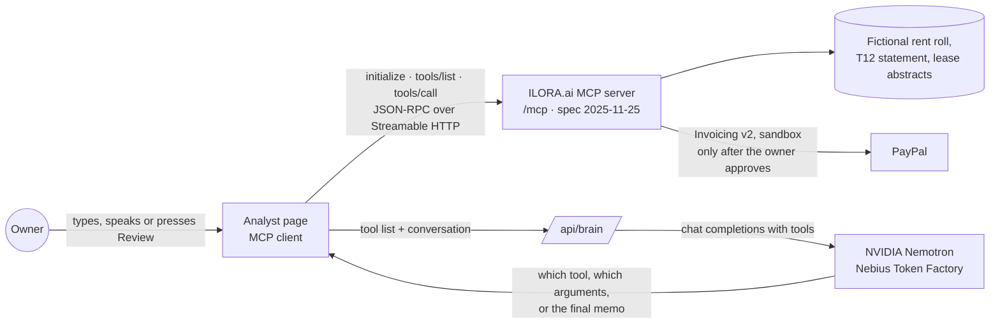

# ILORA.ai Rent Collector

**Small commercial property owners lose rent they never billed. ILORA.ai finds it in the lease, the rent roll and the ledger, drafts a PayPal invoice for each tenant who owes, sends it once the owner approves, and keeps the tally of what came in.**

> **Find rent to collect**
>
> You can bill $14,190 now: $9,000 to Harbor Light Pilates at Coral Wren Plaza for a March rent increase that was never billed, and $5,190 to the Jaramillo household at Tamarind Grove Apartments for two months with no rent posted.
>
> **Bill Harbor Light Pilates.** *(The owner clicks Approve and send.)*
> Sent. Harbor Light Pilates has a PayPal invoice for $9,000, due in 10 days.
>
> **They paid by check.** *(Approve and record.)*
> Recorded $9,000. The invoice is paid in full. $5,190 has not been invoiced yet.

**Read this first, plainly:**
- **Nothing reaches PayPal without the owner's click.** The two tools that change anything (send an invoice, record a payment) are marked as writes in MCP, and the page shows an approval card before either runs. Sending the same bill twice returns the first invoice instead of billing the tenant again.
- **The model never produces a number.** NVIDIA Nemotron decides which tool to call and writes the words. Every amount comes from a deterministic check over the documents, and the tests assert each one to the dollar.
- **PayPal runs in sandbox, and all data is fictional.** Coral Wren Plaza, Tamarind Grove Apartments, their tenants and every number are made up; tenant emails are on example.com. The code refuses any PayPal host other than the sandbox.

## Why

An independent owner's lease says the rent steps up in March. The recurring charge in the accounting system was never changed, so six months go out at the old rate and nobody notices until a lender, a buyer or an audit does. Large firms pay staff to tie the lease, the rent roll and the ledger together every month. The owner of one strip center or one small apartment building does it alone, if at all, and then still has to write and chase the bill.

## Run it locally in five minutes

Needs Node.js 20 or later.

```bash
git clone https://github.com/gSimani/ilora-rent-collector.git
cd ilora-rent-collector
npm install
npm run dev
```

Open http://localhost:8787. With no key, a rules-based planner stands in for the model, so the page and the tests run offline.

To use NVIDIA Nemotron on Nebius Token Factory, create an API key in [Token Factory](https://tokenfactory.nebius.com/) and start with:

```bash
BRAIN=nemotron NEBIUS_API_KEY=your-key npm start
```

To bill through PayPal, create a sandbox REST app at [developer.paypal.com](https://developer.paypal.com/dashboard/applications/sandbox) and add its keys:

```bash
BRAIN=nemotron NEBIUS_API_KEY=your-key PAYPAL_CLIENT_ID=your-id PAYPAL_CLIENT_SECRET=your-secret npm start
npm run sandbox:reset   # cancels every demo invoice so the next run starts clean
```

Without PayPal keys the page still finds the rent to collect and says plainly that PayPal is not connected. Add `VOICE=polly` with AWS credentials to hear answers in an Amazon Polly generative voice; otherwise the browser voice reads them. The header of every answer names the model that wrote it.

Run the tests:

```bash
npm test
```

## How it works



1. The page connects to the MCP server and lists its nine tools.
2. Each step, the page sends the conversation and the tool list to `/api/brain`. The server passes them to Nemotron as function definitions through Token Factory's chat-completions endpoint.
3. Nemotron returns a tool call. The page runs it over MCP and sends the structured result back.
4. If the tool would change something outside the page (send an invoice, record a payment), the page shows what it will do and waits for the owner's click. Declining sends Nemotron an "owner declined" result and nothing reaches PayPal.
5. When Nemotron has what it needs, it writes the answer. The right-hand panel keeps a running ledger: what is owed, what was billed, what came in.

**A claim needs a call behind it.** While recording the demo, Nemotron 3 Nano once answered "Recorded payment" without calling any tool, and once invented a $1,000 payment the owner never mentioned. Two guards now stop both: an answer that says money was sent or recorded, with no write tool run since the owner spoke, gets one retry that names the tool the owner asked for (and if it still claims without acting, the owner is told nothing was done); and a payment amount is kept only if the owner said that figure. The code is in [src/assistant/nemotron.ts](src/assistant/nemotron.ts) and [simulator/src/amount.ts](simulator/src/amount.ts).

**PayPal is the record.** Each invoice carries the check's id in its reference field, so the server keeps no state of its own. Status, totals and the "already sent" guard are all read back from PayPal. The code is in [src/paypal.ts](src/paypal.ts).

**Two Nemotron sizes.** Ordinary questions go to the newest Nemotron Nano listed for the key, so answers stay quick and cheap. The portfolio review goes to the newest Nemotron Super, which plans the full sequence of checks and writes the memo. Both are picked from `GET /v1/models` at startup and can be pinned with `NEMOTRON_FAST_MODEL` and `NEMOTRON_MODEL`. The code is in [src/assistant/nemotron.ts](src/assistant/nemotron.ts).

## The tools

One owner question per tool; nine in all. Every tool declares an `outputSchema` and returns matching `structuredContent`. Errors come back with `isError` and a JSON body that offers alternatives.

| Tool | Owner asks | Returns |
|---|---|---|
| `list_properties` | "What properties do I have?" | id, name, type and city for each property |
| `get_property_snapshot` | "How is Coral Wren Plaza doing?" | occupancy, rent roll rent and statement rental income (trailing 12 months), NOI, open flag count, top flag |
| `check_rent_roll_vs_statement` | "Does my rent roll match my income statement?" | both totals, the gap, ranked causes with reason, fix and source document, page and line. Shown as a Card |
| `list_expiring_leases` | "Which leases expire in the next 90 days?" | leases ending in `months_ahead` with rent and share of income. Shown as a List |
| `explain_flag` | "Show me the lines" | every source citation and the suggested fix |
| `draft_rent_invoices` | "What rent can I bill?" | every amount a tenant owes, largest first, with its invoice line and any invoice already sent. Sends nothing |
| `send_rent_invoice` | "Bill Harbor Light Pilates" | creates and sends the PayPal invoice, or returns the one already sent. **Write: the owner approves first** |
| `rent_collection_status` | "Who still owes me?" | each bill with its PayPal status, plus totals billed, collected and still due |
| `record_rent_payment` | "They paid by check" | marks the PayPal invoice paid for that amount. **Write: the owner approves first** |

Only amounts a tenant owes become invoices. The $4,500 CAM reconciliation posted to base rent is a bookkeeping fix, so it stays out.

## The demo data

| Property | Type | What the review finds |
|---|---|---|
| Coral Wren Plaza, Delray Beach, FL | 12-suite neighborhood retail center | Rent roll $412,000 vs statement $398,500. Gap $13,500 = Suite 104's March rent step never billed ($9,000) + a CAM reconciliation credit posted to base rent ($4,500) |
| Tamarind Grove Apartments, Boynton Beach, FL | 48-unit garden apartments | 3 leases end within 90 days, 9.0% of rent roll income; Unit B-12 shows occupied with no rent posted for July and August ($5,190) |

Files per property in [data/](data/): `rent_roll.csv`, `t12_operating_statement.csv` (general-ledger detail with document, page and line), lease abstracts as JSON, and `property.json`. Regenerate with `npm run data`.

## Deploy

One AWS Lambda function with a function URL serves the page, the MCP endpoint and `/api/brain`; the model itself runs on Nebius Token Factory.

```bash
npm run build:lambda
sam deploy --guided --template-file template.yaml
```

Stack parameters: `Brain` (`nemotron` or `offline`), `NebiusApiKey`, `PayPalClientId`, `PayPalClientSecret`, `Voice` (`polly` or `browser`). `/api/brain` and `/api/speak` cap requests per hour per caller and in total, which bounds what a public URL can spend. Remove everything with `sam delete`.

## Project layout

```
src/assistant/nemotron.ts  Nemotron on Nebius Token Factory: tool calling, model choice, review prompt
src/assistant/planner.ts   Offline stand-in for the model, and the review memo it writes
src/assistant/routes.ts    /api/brain, /api/speak (Polly), /api/config
src/server.ts              MCP server and the nine tools
src/paypal.ts              PayPal Invoicing v2 (sandbox only): bills, send, payments, status, reset
src/domain.ts              The checks: reconciliation, expirations, flags, snapshot
src/ui.ts                  Card and List views (MCP Apps ui:// resources)
simulator/                 The analyst page
tests/                     Data, tools, PayPal invoicing, golden conversation, Nemotron wiring, portfolio review
data/                      Fictional demo dataset
```

## What is new in this hackathon

This project builds on our ILORA.ai MCP server for property checks, written October 19 to 23, 2026, inside this hackathon's submission period. Added for this entry:

- **PayPal Invoicing v2**: four new MCP tools that draft, send and track rent invoices, and record payments received by check, cash or transfer.
- **Owner approval before every write**: the tools that touch PayPal are annotated as writes, and the page shows an approval card before either runs.
- **No claims without a call, no invented amounts**: guards measured against real Nemotron output, described above.
- **No double billing**: each invoice carries the check's id, and sending again returns the invoice already sent.
- **A live collection ledger** on the page: owed, billed, collected and still due, with the tenant's PayPal invoice link.
- **17 new tests** against an in-memory copy of the PayPal endpoints, plus one recorded sandbox round trip.

## License

[MIT](LICENSE), copyright Ilora AI, Inc.

The license covers this code. It does not grant any right to use the ILORA.ai name, logo or brand.
